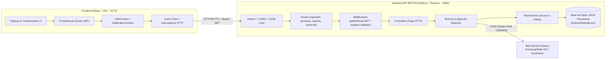

# POSCore ERP — Sistema de Gestión de Inventario y Cotizaciones de Terminales Punto de Venta

Aplicación web Full-Stack desarrollada desde cero con **Node.js + Express (Backend)** y **React + Vite + Tailwind CSS (Frontend)** bajo una **Arquitectura Limpia por Capas (MVC)** y el patrón de diseño **Repository / Service**.

---

## 1. Arquitectura de Software

El proyecto utiliza una arquitectura cliente-servidor desacoplada organizada en **npm workspaces** (`backend/` y `frontend/`).

### Diagrama de Capas



### Estructura de Directorios

```text
riveramorenogezrelmisaelUnidad3/
├── package.json                      # Configuración de workspaces y scripts globales
├── README.md                         # Documentación técnica completa
├── backend/
│   ├── package.json
│   ├── vitest.config.js              # Configuración de pruebas con Vitest
│   ├── .env.example                  # Variables de entorno de ejemplo
│   ├── data/
│   │   └── db.json                   # Almacenamiento JSON persistente (autogenerado con datos iniciales)
│   ├── src/
│   │   ├── app.js                    # Configuración de Express, Helmet, CORS y rutas
│   │   ├── server.js                 # Punto de entrada HTTP
│   │   ├── config/env.js             # Gestión centralizada de configuración
│   │   ├── repositories/             # Patrón Repository (acceso a datos)
│   │   │   ├── jsonDatabase.js
│   │   │   ├── userRepository.js
│   │   │   ├── productRepository.js
│   │   │   └── quoteRepository.js
│   │   ├── services/                 # Patrón Service (lógica de negocio y APIs externas)
│   │   │   ├── authService.js
│   │   │   ├── productService.js
│   │   │   ├── quoteService.js
│   │   │   └── exchangeRateService.js
│   │   ├── controllers/              # Controladores HTTP (MVC)
│   │   │   ├── authController.js
│   │   │   ├── productController.js
│   │   │   ├── quoteController.js
│   │   │   └── externalController.js
│   │   ├── middlewares/              # Middlewares de seguridad, validación y errores
│   │   │   ├── authMiddleware.js
│   │   │   ├── validateMiddleware.js
│   │   │   └── errorMiddleware.js
│   │   ├── validators/               # Reglas de express-validator
│   │   │   ├── authValidator.js
│   │   │   ├── productValidator.js
│   │   │   └── quoteValidator.js
│   │   ├── routes/                   # Definición de endpoints REST
│   │   │   ├── index.js
│   │   │   ├── authRoutes.js
│   │   │   ├── productRoutes.js
│   │   │   ├── quoteRoutes.js
│   │   │   └── externalRoutes.js
│   │   └── utils/AppError.js
│   └── tests/
│       └── api.test.js               # Suite de pruebas automatizadas (Vitest + Supertest)
└── frontend/
    ├── package.json
    ├── vite.config.js
    └── src/
        ├── api/client.js             # Cliente Axios con interceptores JWT y monitor HTTP
        ├── context/                  # AuthContext y NotificationContext
        ├── components/               # Layout, PrivateRoute, SecurityStatusModal, ExchangeRateWidget, etc.
        ├── pages/                    # Login, Register, Dashboard, Inventario POS, Cotizaciones
        └── utils/format.js
```

---

## 2. Patrones de Diseño Aplicados

| Patrón | Ubicación | Propósito |
| --- | --- | --- |
| **Arquitectura por Capas / MVC** | `routes` → `controllers` → `services` → `repositories` | Separación estricta de responsabilidades entre transporte HTTP, reglas de negocio y persistencia. |
| **Repository Pattern** | `backend/src/repositories/` | Encapsula las operaciones de lectura/escritura sobre `db.json`, permitiendo migrar a PostgreSQL/MySQL/SQLite sin modificar servicios ni controladores. |
| **Service Layer Pattern** | `backend/src/services/` | Centraliza lógica de negocio (cálculo de IVA 16%, validación de SKU único, conversión USD/MXN, firma JWT y cifrado bcrypt). |
| **Chain of Responsibility (Middlewares)** | `backend/src/middlewares/` | Encadena protección de cabeceras (`helmet`), `cors`, autenticación `authenticateJWT`, validación `express-validator` y manejo centralizado de errores. |
| **Singleton** | `jsonDatabase.js`, `exchangeRateService.js` | Mantiene una instancia única para la caché de tipo de cambio y el gestor atómico de persistencia JSON. |
| **Provider / Context & Interceptor** | `frontend/src/context/`, `frontend/src/api/client.js` | Gestiona el estado global de sesión JWT, notificaciones HTTP y adjunta automáticamente `Authorization: Bearer <token>`. |

---

## 3. Mecanismos de Seguridad Implementados

1. **Autenticación JWT (`jsonwebtoken`)**:
   - Firma tokens con algoritmo **HS256** (`sub`, `email`, `nombre`, `role`, `iss`, `exp`).
   - Se emite al iniciar sesión (`POST /api/auth/login`) o al registrarse (`POST /api/auth/register`).
2. **Encriptación de Contraseñas (`bcryptjs`)**:
   - Todas las contraseñas se cifran con Blowfish bcrypt usando **10 rondas de salt** (`$2a$10$...`) antes de persistirse. Nunca se almacenan ni devuelven en texto plano.
3. **Protección de Rutas (Backend y Frontend)**:
   - **Backend**: `authenticateJWT` valida la cabecera `Authorization: Bearer <token>` y responde `401 Unauthorized` ante tokens ausentes, expirados o manipulados. Incluye soporte RBAC (`authorizeRoles`).
   - **Frontend**: Componente `<PrivateRoute>` bloquea el acceso a `/`, `/inventario` y `/cotizaciones` redirigiendo automáticamente a `/login` si no existe sesión activa.
4. **Validación y Sanitización de Entradas (`express-validator`)**:
   - Validación de tipos, longitudes, rangos numéricos, formatos de email/SKU y sanitización (`trim()`, `escape()`, `normalizeEmail()`). Ante entradas inválidas responde `400 Bad Request` con el detalle por campo.
5. **Hardening HTTP (`helmet` + `cors`)**:
   - `helmet` añade cabeceras de seguridad (`X-Content-Type-Options: nosniff`, `X-Frame-Options: SAMEORIGIN`, etc.).
   - `cors` restringe orígenes y cabeceras permitidas (`http://localhost:5173`).
6. **Panel Visual "Estado de Seguridad"**:
   - Disponible desde la barra superior y desde el Dashboard. Muestra el token JWT activo truncado, opción para inspeccionar el payload decodificado, rol del usuario, prefijo del hash `bcrypt` y un botón interactivo **"Probar sin Token (401)"** que demuestra en vivo el bloqueo de endpoints privados.

---

## 4. Documentación de Web Services

### A. Web Services Propios (API RESTful — `http://localhost:4000/api`)

#### Autenticación y Seguridad (`/api/auth`)
| Método | Endpoint | Protección | Descripción | Códigos HTTP |
| --- | --- | --- | --- | --- |
| `POST` | `/api/auth/register` | Pública | Registra un usuario, cifra contraseña con bcrypt y devuelve JWT | `201 Created`, `400`, `409` |
| `POST` | `/api/auth/login` | Pública | Verifica credenciales con bcrypt y devuelve JWT activo | `200 OK`, `400`, `401` |
| `GET` | `/api/auth/me` | Privada (JWT) | Obtiene el perfil del usuario autenticado | `200 OK`, `401` |
| `GET` | `/api/auth/security-status` | Privada (JWT) | Devuelve diagnóstico de seguridad y token truncado | `200 OK`, `401` |

#### Inventario de Terminales POS (`/api/products`)
| Método | Endpoint | Protección | Descripción | Códigos HTTP |
| --- | --- | --- | --- | --- |
| `GET` | `/api/products` | Privada (JWT) | Lista terminales POS con filtros opcionales (`?search=&estado=`) y KPIs | `200 OK`, `401` |
| `GET` | `/api/products/:id` | Privada (JWT) | Obtiene detalle de una terminal POS por ID | `200 OK`, `404`, `401` |
| `POST` | `/api/products` | Privada (JWT) | Crea una nueva terminal POS validando SKU único y campos | `201 Created`, `400`, `409` |
| `PUT` | `/api/products/:id` | Privada (JWT) | Actualiza atributos de una terminal y recalcula estado de stock | `200 OK`, `400`, `404`, `409` |
| `DELETE` | `/api/products/:id` | Privada (JWT) | Elimina una terminal del catálogo | `200 OK`, `404` |

#### Cotizaciones (`/api/quotes`)
| Método | Endpoint | Protección | Descripción | Códigos HTTP |
| --- | --- | --- | --- | --- |
| `GET` | `/api/quotes` | Privada (JWT) | Lista cotizaciones registradas | `200 OK`, `401` |
| `POST` | `/api/quotes` | Privada (JWT) | Crea cotización calculando subtotal, IVA 16%, total MXN y total USD | `201 Created`, `400` |
| `PATCH` | `/api/quotes/:id/status` | Privada (JWT) | Cambia estado (`BORRADOR`, `ENVIADA`, `APROBADA`, `RECHAZADA`) | `200 OK`, `400`, `404` |
| `DELETE` | `/api/quotes/:id` | Privada (JWT) | Elimina una cotización | `200 OK`, `404` |

### B. Web Service de Terceros (Tipo de Cambio en Tiempo Real)

- **Endpoint interno integrador**: `GET /api/external/exchange-rate` (opcional `?refresh=true`, protegido con JWT).
- **Fuente Externa Primaria**: `https://api.exchangerate-api.com/v4/latest/USD` (**ExchangeRate-API**).
- **Fuente Externa de Respaldo**: `https://api.frankfurter.app/latest?from=USD&to=MXN` (**Frankfurter API**).
- **Uso en el sistema**: Convierte automáticamente en tiempo real el valor total del inventario, los precios unitarios de cada terminal POS en la tabla de catálogo y el monto total de cada cotización de **MXN a USD**, mostrando explícitamente la etiqueta de origen externo en el Dashboard y en Inventario.

---

## 5. Instalación y Ejecución Local

### Requisitos previos
- **Node.js** v18 o superior (probado en Node.js v22)
- **npm** v9 o superior

### Pasos de instalación

1. Instalar todas las dependencias (raíz, backend y frontend en un solo comando gracias a npm workspaces):
   ```bash
   npm install
   ```

2. (Opcional) Configurar variables de entorno en `backend/.env` tomando como base `backend/.env.example`. Si no se crea `.env`, el sistema usa valores seguros por defecto para desarrollo local.

3. Iniciar Backend y Frontend simultáneamente:
   ```bash
   npm run dev
   ```
   - **Frontend (React + Vite)**: `http://localhost:5173`
   - **Backend (API Express)**: `http://localhost:4000/api`

### Credenciales Demo Precargadas (Cifradas con Bcrypt)

| Rol | Correo Electrónico | Contraseña |
| --- | --- | --- |
| `ADMIN` | `admin@poscore.mx` | `Admin123!` |
| `VENDEDOR` | `vendedor@poscore.mx` | `Vendedor123!` |

*(También es posible registrar cuentas nuevas desde `/register`).*

---

## 6. Ejecución de Pruebas Automatizadas

El proyecto incluye pruebas de integración y seguridad configuradas con **Vitest** y **Supertest** (`backend/tests/api.test.js`) que validan:
- Cabeceras HTTP de `Helmet`.
- Registro de usuarios con verificación de hash `bcrypt` en base de datos.
- Login exitoso (`200 OK`), credenciales inválidas (`401 Unauthorized`) y errores de validación (`400 Bad Request`).
- Bloqueo de rutas privadas sin token o con token inválido (`401 Unauthorized`).
- Flujo CRUD completo sobre `/api/products` (`POST 201`, `GET 200`, `PUT 200`, `DELETE 200`).
- Consumo del Web Service externo de tipo de cambio y creación de cotizaciones con IVA y conversión USD.

Para ejecutar la suite completa:

```bash
npm test
```
